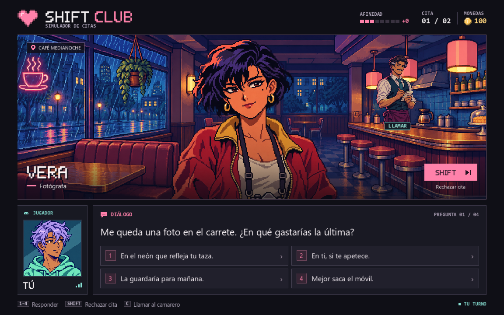

# Shift Club

Una noche en el Café Medianoche con Vera, fotógrafa, y Nico, DJ. Cada pregunta ofrece cuatro respuestas. La afinidad cambia con tus decisiones y cualquiera de los dos puede poner fin a la cita.

Abre `game-jam/project.godot` con Godot 4.7 y pulsa **F5**. Haz clic en una respuesta o usa las teclas **1–4**. El botón o la tecla **SHIFT** rechazan la cita. **Enter** avanza tras una presentación o una despedida.

Empiezas cada partida con 100 monedas. El saldo aparece en la esquina superior derecha y se conserva entre citas. Para ajustar la cantidad inicial en el editor, selecciona **PlayerWallet** en `res://main.tscn` y cambia **Starting Coins** en el Inspector.

En algunas preguntas aparece el camarero junto a la barra. Haz clic en él o pulsa **C** para llamarlo. Al elegir una bebida, pagas el precio de la carta e invitas al NPC. Su reacción muestra cuánto cambia la afinidad. Puedes invitar una vez por pregunta. **Ahora no** o **Esc** cierran la carta y te devuelven a la misma conversación. [Ver la carta en el juego](carta-del-cafe.png)

## Editar una cita

En el panel **Sistema de archivos**, abre `res://content/vera.tres` o `res://content/nico.tres`. El Inspector muestra el nombre, la ocupación, el lugar, el retrato y el fondo. Para cambiar una imagen, importa la nueva textura al proyecto y arrástrala a **Portrait** o **Background**.

El escenario admite retratos PNG con fondo transparente. El avatar del jugador se encuentra en `res://art/player.png`. Puedes sustituirlo por otra imagen cuadrada con el mismo nombre.

**Opening Lines** contiene las frases que el NPC dice antes de preguntar. Déjalo vacío para mostrar directamente la primera pregunta. **Questions** fija el orden de la conversación. Abre cada pregunta para editar **Prompt** y sus cuatro **Answers**. Cada respuesta tiene un **Text** visible y un **Score Delta** que suma o resta afinidad.

Cada respuesta admite también una **Reply** opcional. El NPC dice esa réplica al presentar la siguiente pregunta. Puedes dejarla vacía para pasar directamente a la pregunta. Al terminar la cita, el NPC usa la frase de despedida del perfil.

**Starting Score** fija la afinidad inicial. Si una respuesta deja el total en **Rejection Threshold** o por debajo, el NPC termina la cita con **Rejected Line**. Tras la última pregunta, alcanzar **Success Threshold** activa **Success Line**. El resto de citas que llegan al final usan **Neutral Line**.

## Editar el servicio de bebidas

- En el recurso de una pregunta, activa **Waiter Available** para que el camarero aparezca en la barra durante esa intervención.
- En `res://content/drinks/` puedes editar el nombre, descripción, precio e icono de cada bebida. Para añadir una, crea un recurso **CafeDrink** y arrástralo al array **Drinks** de `res://content/drink_menu.tres`. El orden del array es el de la carta.
- En el perfil del NPC, añade una **DrinkPreference** a **Drink Preferences**, selecciona el mismo recurso de bebida que en la carta e indica su **Affinity Gain** y su **Reply**. Una bebida sin preferencia asignada usa **Default Drink Reply** y aporta cero puntos.

## Añadir un NPC

1. Duplica un perfil `.tres` de `res://content/` con un nombre nuevo. Sus preguntas y respuestas están guardadas en el propio archivo.
2. Edita el perfil duplicado. Para ampliar el diálogo, añade un recurso **DateQuestion** al array **Questions** y asígnale cuatro recursos **DateAnswer** en **Answers**.
3. Abre `res://content/catalog.tres`, añade un elemento a **Encounters** y arrastra el nuevo perfil a ese espacio. El orden del array determina el orden de las citas.
4. Guarda los recursos y pulsa F5 para probar el recorrido completo.
